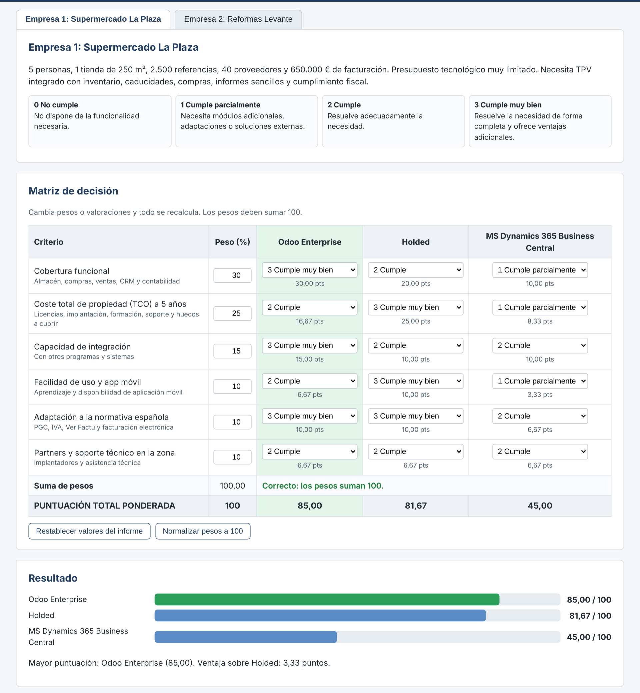
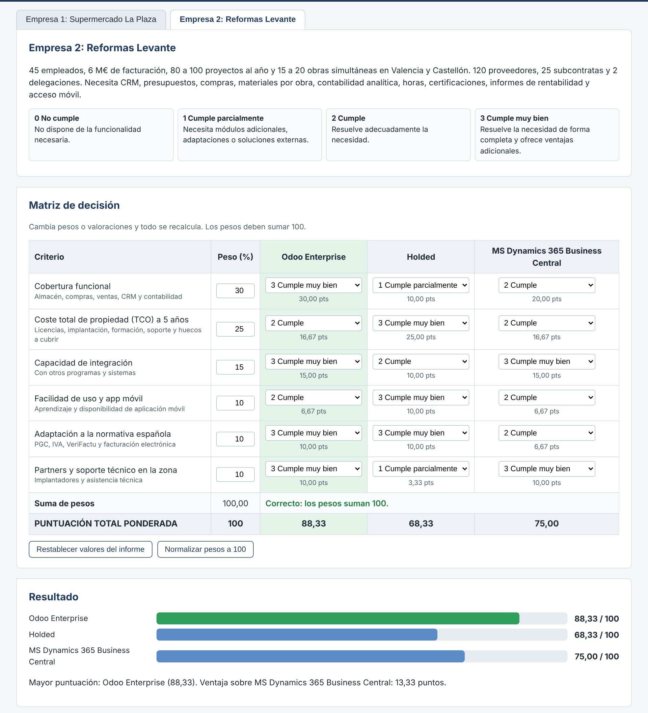

# Actividad evaluable 01: selección de un ERP

**Asignatura:** Sistemas de Gestión Empresarial, UT1
**Autores/as:** Melisa Vafaeva y Daniel Dimitrov
**Entrega:** 21 de noviembre de 2026

## 1. Las dos matrices

Matriz programada en HTML y JavaScript: se pueden cambiar los pesos y las valoraciones (escala de 0 a 3) y el total se recalcula con la fórmula del enunciado, (valoración x peso) / 3. Las capturas son de la propia página.

**Empresa 1: Supermercado La Plaza**

**Empresa 2: Reformas Levante**

| Puntuación sobre 100 | Odoo Enterprise | Holded | MS Dynamics 365 Business Central |
|:-|:-:|:-:|:-:|
| Empresa 1, supermercado | **85,00** | 81,67 | 45,00 |
| Empresa 2, reformas | **88,33** | 68,33 | 75,00 |

## 2. Empresa 1: Supermercado La Plaza

### Conclusión: Odoo Enterprise

Elegimos Odoo (plan Standard) porque el problema principal del supermercado es que la caja, el stock y las compras no están conectados, y hay roturas de stock y compras excesivas de perecederos. En Odoo el TPV, el inventario, las compras y la contabilidad son aplicaciones de la misma base de datos, así que cada venta descuenta stock y se pueden controlar lotes y caducidades sin módulos de terceros. Business Central no tiene TPV propio y cuesta unas cinco veces más para un negocio de 650.000 € de facturación, por lo que no tiene sentido en un comercio tan pequeño (tampoco SAP Business One, que está en un rango de costes aún mayor). Holded (81,67 puntos) sería una alternativa razonable y más barata de implantar, pero no hemos encontrado control de caducidades, que es justo lo que más duele a este negocio. Si el supermercado no puede pagar la implantación de Odoo (unos 5.000 €), Holded es el plan B.

### Punto 1: TPV integrado con inventario y caducidades (cobertura funcional, 30 %)

| ERP | Qué hemos encontrado | Valoración |
|:-|:-|:-:|
| Odoo | Solución propia para supermercados con punto de venta e inventario integrados. La documentación de inventario describe cómo activar fechas de caducidad en los lotes. Todo en una sola base de datos, sin conectores. | 3 |
| Business Central | No incluye un TPV nativo: el punto de venta se añade con extensiones de partners (por ejemplo LS Central [4]), con coste y soporte aparte y una integración que hay que mantener. | 1 |

Fuentes: [1] [2] [3] [4].

### Punto 2: Coste total de propiedad a 5 años (25 %)

| Concepto | Odoo | Business Central |
|:-|-:|-:|
| Licencias (5 usuarios, 60 meses) | 7.470 € (24,90 €/usuario/mes) | 20.790 € (69,30 €/usuario/mes) |
| TPV | incluido | 6.000 € (estimación) |
| Implantación | 5.000 € | 20.000 € |
| Formación | 1.000 € | 1.500 € |
| Soporte del partner | 2.500 € | 3.000 € |
| **Total** | **15.970 €** | **51.290 €** |

Business Central cuesta 3,2 veces más que Odoo. Los rangos de implantación (5.000 a 25.000 € Odoo y 20.000 a 60.000 € Business Central) vienen de un comparador, no de un presupuesto real, y la formación, el soporte y el TPV de tercero son estimaciones nuestras. Aun así, incluso con un paquete básico de implantación de 3.000 € en Business Central, el total seguiría muy por encima del de Odoo. Fuentes: [5] [6] [7] [8].

## 3. Empresa 2: Reformas Levante

### Conclusión: Odoo Enterprise

Elegimos Odoo porque une en una sola base de datos todo el ciclo de una reforma: oportunidad comercial, presupuesto, compras, materiales por obra, horas, contabilidad analítica y rentabilidad. Eso responde a los problemas de la empresa (presupuestos en Excel, información repartida y falta de control de costes reales por obra). Un ERP generalista es suficiente como base, pero hace falta una capa de gestión de obra para importar mediciones en formato BC3 y para las certificaciones, que existe como módulo de terceros en Odoo y como vertical de partners en Business Central. No recomendamos un software de obras independiente, porque repetiría el problema actual de datos repartidos. La capacidad de personalizar es decisiva, porque la empresa se diferencia por cómo presupuesta (por partidas) y cómo certifica. Business Central (75,00 puntos) es una alternativa sólida, con partners especializados en construcción, pero sale más cara en 5 años.

### Punto 1: Control de costes por obra y personalización (cobertura funcional, 30 %)

| ERP | Qué hemos encontrado | Valoración |
|:-|:-|:-:|
| Odoo | Solución para contratistas de reforma con estimación de mano de obra y materiales por partida y márgenes en tiempo real. Contabilidad analítica enlazada con compras, almacén y partes de horas. Caso real en España (Biecsa) con control de presupuestos por partidas y desviaciones. Para certificaciones y BC3 existe un módulos de terceros como ES Presupuestos Obra [12]. A validar en una demo. | 3 |
| Business Central | Módulo de proyectos (Jobs) con presupuesto, recursos, partes de horas, compras y facturación por proyecto. Un partner indica que lo nativo basta con menos de 15 proyectos activos y un solo modelo de facturación. Reformas Levante tiene 15 a 20 obras y certificaciones, así que necesitaría una vertical de obra de un partner. | 2 |

Fuentes: [9] [10] [11] [12] [13] [14].

### Punto 2: Coste a 5 años y partners en la zona (TCO 25 % y partners 10 %)

| Concepto (25 usuarios) | Odoo | Business Central |
|:-|-:|-:|
| Licencias | 67.350 € (plan Custom, 44,90 €) | 66.528 € (15 Essentials y 10 Team Member) |
| Implantación y desarrollos | 35.600 € | 55.000 € |
| Formación y soporte | 18.000 € | 24.000 € |
| **Total** | **120.950 €** | **145.528 €** |

Con la misma regla de cálculo, Business Central sale un 20 % más caro, pese a usar licencias más baratas para los jefes de obra. En partners, ambos tienen buena presencia en Valencia: Odoo con partners Gold como Dynapps y Punt Sistemes, y Business Central con consultoras como Datanet o Grupo Tecon y partners especializados en construcción como Davisa. Por eso las dos puntúan 3 en partners y la diferencia la marca el coste. Las verticales, desarrollos, formación y soporte son estimaciones nuestras. Fuentes: [5] [6] [15] [16] [17] [18] [19] [20].

## 4. Herramientas usadas y comentarios sobre la IA

Hemos usado un asistente de IA con búsqueda web (Claude) para localizar y resumir fuentes, y hemos contrastado los datos con las webs oficiales de Odoo, Holded y Microsoft y con fuentes independientes (comparadores, partners y prensa especializada). Recomendaciones o datos de la IA que descartamos o pusimos en duda:

1. **"Holded está homologado por la AEAT para Verifactu"** (lo dice la web de Holded). La AEAT no homologa programas: cada fabricante firma una declaración responsable [21].
2. **Precios contradictorios** (Odoo a 31,10 USD, 24,90 € y 44,90 €; Holded a 29/59/99 € y a 34/69/115/229 €). Descartamos los de EE. UU. y los antiguos, y usamos los de España y los oficiales [5] [22].
3. **"Obligatorio desde enero de 2026"** para Verifactu. Estaba desactualizado: hubo aplazamientos y en octubre de 2026 se anunció otro hasta octubre de 2028, aún pendiente de norma con rango de ley [23].
4. **"Business Central no incluye Verifactu"**, afirmado por un proveedor que vende su propia extensión. Microsoft Learn documenta un modo integrado, así que nos fiamos de Microsoft y lo dejamos para verificar con un partner [24].

## 5. Fuentes

Consultadas el 16 de noviembre de 2026.

1. Odoo, solución para supermercados. <https://www.odoo.com/es_ES/industries/grocery-store>
2. Odoo, documentación de inventario (fechas de caducidad). <https://www.odoo.com/documentation/18.0/es/applications/inventory_and_mrp.html>
3. Ecosire, TPV retail para Business Central (no es nativo). <https://ecosire.com/es/apps/dynamics-365-business-central/d365-retail-pos>
4. LS Retail, LS Central: TPV y retail sobre Business Central. <https://www.lsretail.com/products/ls-central>
5. Softabase, precios reales de Odoo en España. <https://softabase.com/es/guides/odoo-community-vs-enterprise-vs-cloud-pricing>
6. Microsoft, precios de Business Central (España). <https://www.microsoft.com/es-es/dynamics-365/products/business-central/pricing>
7. Hackceleration, software Verifactu para pymes (precio de Business Central). <https://hackceleration.com/labs/best/verifactu-software-smes-spain>
8. Ecosistema Startup, ERP para pymes 2026 (rangos de implantación). <https://ecosistemastartup.com/?p=119532>
9. Odoo, solución para construcción. <https://www.odoo.com/es_ES/industries/construction>
10. Odoo, contratistas de reforma y promotores. <https://www.odoo.com/es/industries/construction/property-developer>
11. Odoo, caso Biecsa. <https://www.odoo.com/es/customers/biecsa-11219757>
12. Odoo Apps, ES Presupuestos Obra (partidas, importación BC3 y mediciones). <https://apps.odoo.com/apps/modules/19.0/es_presupuestos_obra>
13. Gestisoft, proyectos (Jobs) en Business Central. <https://www.gestisoft.com/en/blog/projects-business-central>
14. Davisa, ERP para construcción sobre Business Central. <https://davisa.es/en/blog/best-construction-erp-business-central/>
15. Softabase, ficha de Odoo (precios de octubre de 2026). <https://softabase.com/es/software/erp/odoo>
16. MS Dynamics World, Essentials frente a Premium y Team Member. <https://msdynamicsworld.com/node/39442>
17. ERP Research, Dynapps (Odoo Gold, Valencia). <https://erpresearch.com/odoo-partners/dynapps-es-sl>
18. ERP Research, Punt Sistemes (Odoo Gold, Paterna). <https://erpresearch.com/odoo-partners/punt-sistemes-slu>
19. Cloudtango, partners de Dynamics en España. <https://www.cloudtango.net/dynamics/es/>
20. Datanet Consultores. <https://proveedores.com/proveedores/datanet-consultores/>
21. Hackceleration, Verifactu y declaración responsable. <https://hackceleration.com/labs/best/verifactu-software-smes-spain>
22. Holded, precios oficiales. <https://www.holded.com/es/precios>
23. Emprendedores, aplazamiento de Verifactu a octubre de 2028. <https://emprendedores.es/gestion/aplazamiento-verifactu-2028/>
24. Microsoft Learn, VERI*FACTU en Business Central. <https://learn.microsoft.com/en-us/dynamics365/business-central/localfunctionality/spain/enable-real-time-invoice-reporting>
